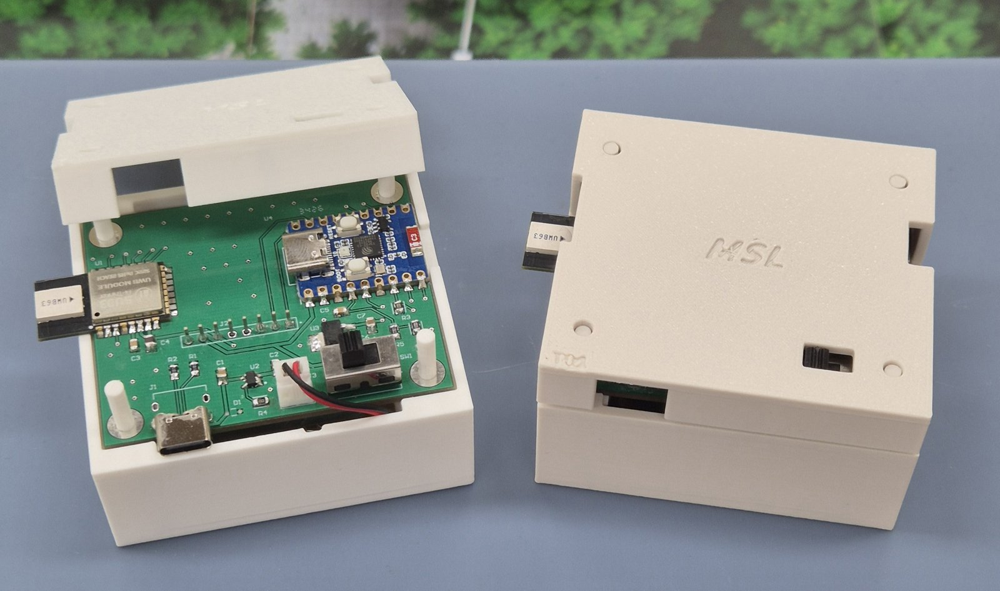
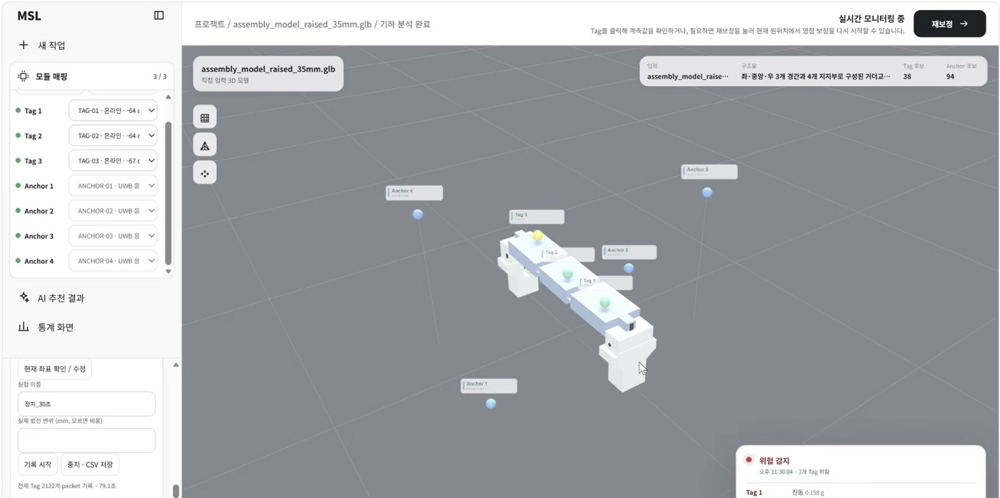
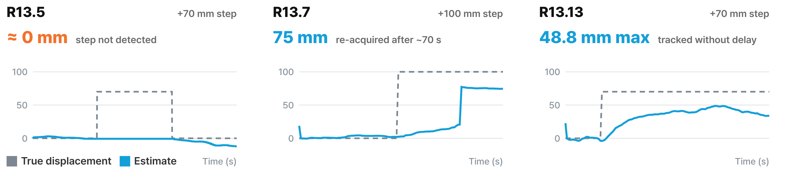
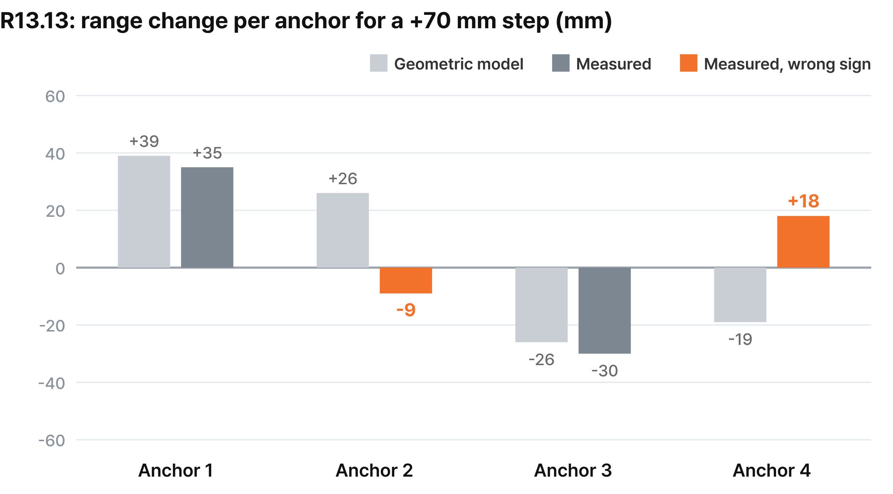
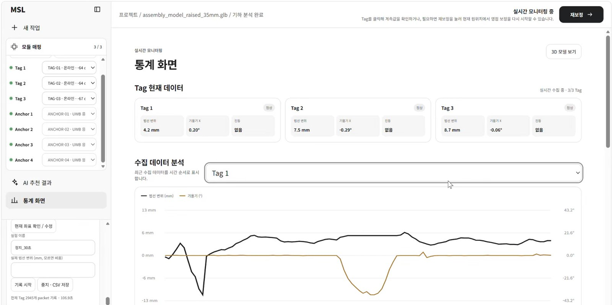

# Structural Digital Twin Monitoring

UWB/IMU sensing system that tracks displacement, tilt, and vibration of structures under demolition and mirrors their state in a web-based 3D digital twin.

<p align="center">
  
  &nbsp;
  
</p>

**2026 UOS ECE Innovation Fair — Excellence Award** · 3-person team project

## Overview

Each sensor tag (ESP32-C3, DW3000 UWB, ADXL345) ranges to four fixed UWB anchors and reports range and acceleration to a Node.js server over UDP. The server schedules ranging, estimates per-tag displacement from range changes, and streams the state to a Three.js digital twin, where each tag is classified as normal, warning, or danger.

```
Tag ×3 ──UWB TWR──▶ Anchor ×4
  │
  └─ Wi-Fi UDP ──▶ Server (TDMA scheduling, anchor selection, displacement estimation)
                      └─ SSE ──▶ Web digital twin (3D view, risk alerts, CSV logging)
```

| Risk level | Displacement | Tilt | Vibration |
|---|---|---|---|
| Warning | ≥ 15 mm | ≥ 5° | – |
| Danger | ≥ 30 mm | ≥ 10° | ≥ 0.10 g |

## Method

- **TDMA ranging scheduler.** The server assigns ranging slots to each tag and moves to the next tag as soon as a valid packet arrives, so tags do not collide on the shared UWB channel.
- **Adaptive anchor selection.** Each anchor link is scored by displacement sensitivity, recent success rate, range noise, CIR-based NLOS score, and residual. The tag ranges to the best 2 anchors when the projected uncertainty is low enough, escalates to 3 or 4 when link quality drops, and re-checks all anchors every ~2.6 s.
- **Event-triggered verification.** An acceleration event, a range jump above 60 mm, or an NLOS-suspect link triggers ranging to all four anchors.
- **Robust displacement estimation.** NLOS-suspect links are down-weighted, lost tracks are re-acquired by multi-link consensus, and the reference is held fixed during stationary periods.
- **Anchor RX watchdog.** The anchors originally waited for a packet with no RX timeout, and in one field test anchor 3 stopped answering all tags. The firmware now re-arms the DW3000 receiver after 900 ms without an RX event.

## Results

### Synthetic fault tests

Fault patterns injected into the estimator (`server/test/test_fault_fuzz.js`, `npm test`):

| Case | Result |
|---|---|
| +60 mm move while one anchor reads +600 mm off | 61.6 mm estimated |
| Stationary while one anchor drifts by −140 mm | false displacement ≤ 0.9 mm |
| One anchor link lost, +25 mm move | 24.9 mm estimated |

### Field tests by version

A single tag on the structure model was moved by a known step, and the logged estimate was compared across estimator versions.

<p align="center"></p>

| Version | Change | Result | Limitation |
|---|---|---|---|
| R13.5 | A step of 25 mm or more was accepted only when three anchors agreed in the same packet. | +70 mm step held at about 0 mm. | During the move, usually only one anchor was consistent, so the real motion was rejected as an outlier. |
| R13.6–R13.7 | Re-acquisition from two anchors seen at different times; hold when fewer than two links are trusted; anchor RX watchdog. | +100 mm step re-acquired after about 70 s at 77 mm (through same-packet consensus in this run), then held at about 75 mm. | Slow re-acquisition and about 25 mm under-estimation. |
| R13.8–R13.13 | R13.8–R13.10 required evidence rates (e.g. 9 UWB samples within 1.2 s) that the field update rate of about 2 Hz could not meet, so motion was never confirmed. R13.11 returned to the R13.7 tracker with windows sized for 2 Hz. | +70 mm step tracked without delay, peaking at 48.8 mm. | Under-estimation (see below). |

### Error analysis (R13.13)

<p align="center"></p>

- Anchors 1 and 3 changed close to the geometric model (+35 and −30 mm against +35 and −30 mm). Anchors 2 and 4 changed in the opposite direction (−9 and +18 mm against +23 and −22 mm).
- Range noise was high in the field, so the projected uncertainty rarely met the target and the selector requested all four anchors in 99.6% of ranging cycles.
- Using anchors 1 and 3 alone, a linearized offline estimate from the logged ranges gives about 60–75 mm. Mixing in the inconsistent ranges pulled the estimate down.
- The raw ranges are therefore not accurate enough on every link. The next steps are to check the ranging accuracy of the UWB module on its own and the effect of the installation environment (reflective surfaces, occlusion).

The code in this repository is a later version (R14.4) than the field-tested versions above and has not been validated in the field.

## Web Interface

<p align="center"></p>

Upload a 3D model of the structure, map tags and anchors onto it, and monitor per-tag displacement, tilt, and vibration in real time. An optional AI module recommends sensor placement for the uploaded structure. The UI is in Korean.

## Getting Started

**Server** (Node.js ≥ 20)

```bash
cd server
npm install
cp .env.example .env    # optional: OPENAI_API_KEY for AI placement; runs in demo mode without it
npm start               # http://localhost:8080
npm run mock            # simulated tags, no hardware needed
npm test
```

**Firmware** (Arduino IDE, ESP32-C3, DW3000 library)

- `firmware/anchor/anchor.ino`: set `ANCHOR_INDEX` to 1–4 and flash each anchor.
- `firmware/tag/tag.ino`: copy `secrets.example.h` to `secrets.h`, fill in Wi-Fi and the server IP, set `TAG_INDEX` to 1–3, and flash each tag.

## Repository Structure

```
firmware/
  anchor/          UWB responder
  tag/             UWB initiator + accelerometer, UDP telemetry
server/
  server.js        UDP bridge, calibration, SSE stream
  lib/             TDMA scheduler, anchor selection, displacement estimation
  public/          Web digital twin (Three.js)
  test/            Unit and integration tests
docs/media/
```

## Contributions

Minseo Kim designed and assembled the sensor PCB, built the initial web digital twin, developed the scheduling, anchor-selection, and robust-estimation algorithms described above, and ran the field tests with the team. The initial firmware and displacement estimator were written by teammates.
