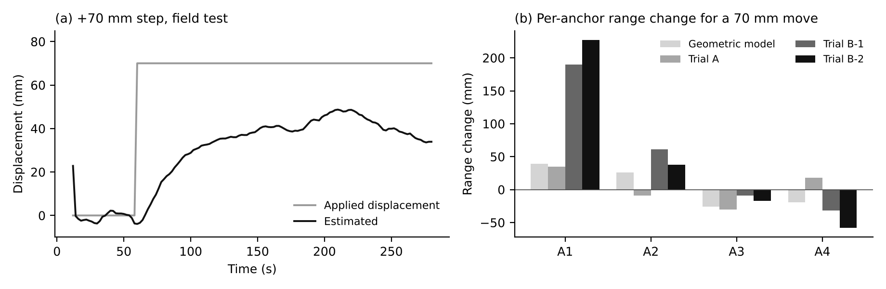

# Structural Digital Twin Monitoring

UWB/IMU sensing system that tracks displacement, tilt, and vibration of structures under demolition and mirrors their state in a web-based 3D digital twin.

<p align="center">
  
  &nbsp;
  
</p>

**2026 UOS ECE Innovation Fair — Excellence Award** · 3-person team project

## Overview

Each sensor tag (ESP32-C3, DW3000 UWB, ADXL345) ranges to four fixed UWB anchors and reports range and acceleration to a Node.js server over UDP. The server schedules ranging, estimates per-tag displacement from range changes, and streams the state to a Three.js digital twin, where each tag is classified as normal, warning, or danger.

```
Tag ×3 ──UWB TWR──▶ Anchor ×4
  │
  └─ Wi-Fi UDP ──▶ Server (TDMA scheduling, anchor selection, displacement estimation)
                      └─ SSE ──▶ Web digital twin (3D view, risk alerts, CSV logging)
```

| Risk level | Displacement | Tilt | Vibration |
|---|---|---|---|
| Warning | ≥ 15 mm | ≥ 5° | – |
| Danger | ≥ 30 mm | ≥ 10° | ≥ 0.10 g |

## Method

- **TDMA ranging scheduler.** The server assigns ranging slots to each tag and moves to the next tag as soon as a valid packet arrives, so tags do not collide on the shared UWB channel.
- **Adaptive anchor selection.** Each anchor link is scored by displacement sensitivity, recent success rate, range noise, CIR-based NLOS score, and residual. The tag ranges to the best 2 anchors in normal operation, escalates to 3 or 4 when link quality drops, and re-checks all anchors every ~2.6 s.
- **Event-triggered verification.** An acceleration event, a range jump above 60 mm, or an NLOS-suspect link triggers ranging to all four anchors.
- **Robust displacement estimation.** NLOS-suspect links are down-weighted, lost tracks are re-acquired by multi-link consensus, and the reference is held fixed during stationary periods.

## Results

<p align="center"></p>

- (a) A +70 mm step was estimated as at most 48.8 mm, and a +100 mm step as 77 mm. The estimator under-tracks static displacement in the field.
- (b) In two trials with the same 70 mm move, the range to anchor A1 changed by 190 mm and 227 mm, about three times the move itself and far beyond the geometric model (39 mm). Because a range cannot change by more than the move, the dominant error comes from raw ranging on that link, not from the estimator.
- Next steps are a physical plausibility check on raw ranges and an adjusted anchor layout.

## Web Interface

<p align="center"></p>

Upload a 3D model of the structure, map tags and anchors onto it, and monitor per-tag displacement, tilt, and vibration in real time. An optional AI module recommends sensor placement for the uploaded structure. The UI is in Korean.

## Getting Started

**Server** (Node.js ≥ 20)

```bash
cd server
npm install
cp .env.example .env    # optional: OPENAI_API_KEY for AI placement; runs in demo mode without it
npm start               # http://localhost:8080
npm run mock            # simulated tags, no hardware needed
npm test
```

**Firmware** (Arduino IDE, ESP32-C3, DW3000 library)

- `firmware/anchor/anchor.ino`: set `ANCHOR_INDEX` to 1–4 and flash each anchor.
- `firmware/tag/tag.ino`: copy `secrets.example.h` to `secrets.h`, fill in Wi-Fi and the server IP, set `TAG_INDEX` to 1–3, and flash each tag.

## Repository Structure

```
firmware/
  anchor/          UWB responder
  tag/             UWB initiator + accelerometer, UDP telemetry
server/
  server.js        UDP bridge, calibration, SSE stream
  lib/             TDMA scheduler, anchor selection, displacement estimation
  public/          Web digital twin (Three.js)
  test/            Unit and integration tests
docs/media/
```

## Contributions

Minseo Kim designed and assembled the sensor PCB, built the initial web digital twin, developed the scheduling, anchor-selection, and robust-estimation algorithms described above, and ran the field tests with the team. The initial firmware and displacement estimator were written by teammates.
